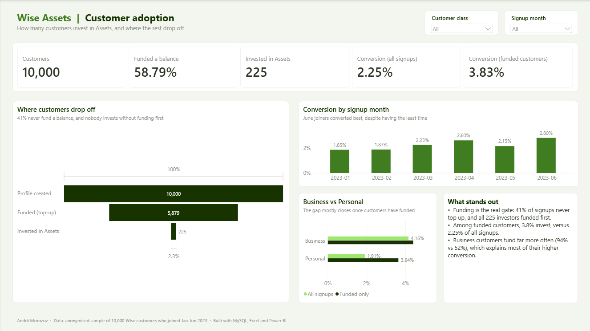
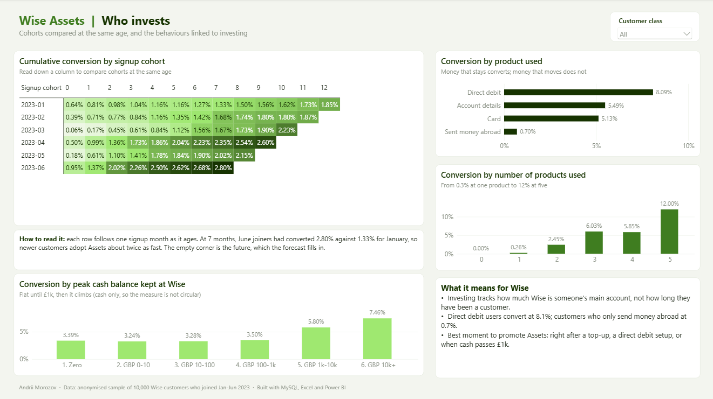
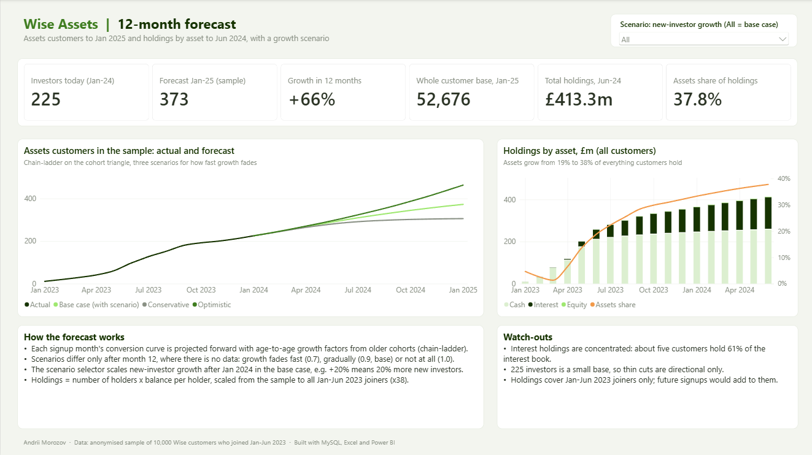

# Wise Assets: who invests, and how many will next year

An end-to-end analysis of how customers adopt **Wise Assets** (Wise's investment feature), built with **MySQL, Excel and Power BI**.

It answers three questions:

1. **How many customers convert to Assets, and what is linked to converting?**
2. **How many Assets customers will there be in 12 months?**
3. **How much will customers hold in Assets in 12 months?**



📊 **[Read the 8-slide summary deck (PDF)](Wise_Assets_Deck.pdf)**

---

## The short answer

| Question | Answer |
|---|---|
| Conversion to Assets | **2.25%** of all signups, **3.83%** of customers who funded a balance |
| Assets customers in the sample, Jan 2024 to Jan 2025 | **225 to 373** (+66%, base case) |
| Assets customers, whole customer base, Jan 2025 | **~52,700** |
| Total holdings, whole customer base, Jun 2024 | **£413.3m**, of which **37.8%** sits in Assets (mostly interest) |

## What I found

**1. Funding is the real gate, not investing.**
41% of signups never put money in a balance, and all 225 investors funded one first. Measured on the customers who *can* invest, conversion is 3.83% rather than 2.25%.

**2. Adoption is speeding up, even though the raw trend says otherwise.**
Monthly new investors seem to fall after mid-2023, but that is just the sample ageing. Compared at the same age (7 months), June 2023 joiners had converted 2.80% against 1.33% for January joiners, more than double.

**3. Investing tracks how much Wise is someone's main account, not how long they've had it.**
Conversion climbs from 0.26% for customers using one product to 12.0% for those using five. Direct debit users convert at 8.1%, while customers who only send money abroad convert at 0.7%.

**4. Money that stays converts, money that moves doesn't.**
Customers who kept £10k+ in cash converted at 7.5%, against about 3.3% for those who kept less than £1k. (I used cash only, since counting equity and interest would make the measure circular.)

**5. Interest, not equity, is the Assets business, and it's concentrated.**
Interest balances grew 177x in six months, while equity stayed small. About five customers hold 61% of the interest book.



## What I'd recommend

- **Report Assets conversion on funded customers, not signups.** Funding is a separate growth problem that accounts for 41% of the drop-off.
- **Prompt Assets on balance behaviour, not tenure.** The best moments are right after a top-up, a new direct debit, or when cash passes £1k.
- **Don't promote Assets on the send-money journey.** It's the largest share of traffic and the least likely to invest.
- **Look after the biggest interest holders.** A handful of balances drive the total, so retaining them is worth more than a month of new adopters.

## The forecast



- **Customers:** chain-ladder on a cohort triangle. Each signup month's conversion curve is projected forward using age-to-age growth factors from older cohorts. Beyond month 12 there's no data, so three scenarios assume growth fades fast (0.7), gradually (0.9, base) or not at all (1.0).
- **Holdings:** number of holders x balance per holder, driven off the customer forecast rather than extrapolated directly, then scaled from the sample to all Jan-Jun 2023 joiners (x38).
- **Check:** the base case implies 8-15 new investors a month in the sample through 2024, against 8-14 actually seen in Oct 2023 to Jan 2024.
- **In Power BI**, a scenario slicer scales new-investor growth after Jan 2024 (from -50% to +50%), and every forecast card updates.

---

## How it's built

```
CSV files ──► MySQL (clean, check, model) ──► views ──┐
                                                       ├──► Power BI (3-page dashboard)
Excel (full analysis + forecast model) ──► PBI tables ─┘
```

| Layer | What it does |
|---|---|
| **MySQL** | Loads the raw data, runs import checks, then rebuilds the funnel, drivers and cohort triangle in SQL. Final views feed Power BI. |
| **Excel** | The full original analysis, plus the forecast model (chain-ladder and holdings). A `PBI_Forecast` tab exposes the forecast as tidy tables. |
| **Power BI** | Imports the SQL views and the Excel forecast tables. 29 DAX measures, a what-if scenario parameter, a DAX-coloured heatmap and a custom theme. |

Every headline number reconciles across all three tools:

| Check | SQL | Excel | Power BI |
|---|---|---|---|
| Signups / funded / invested | 10,000 / 5,879 / 225 | ✓ | ✓ |
| Conversion (all / funded) | 2.25% / 3.83% | ✓ | ✓ |
| Business vs Personal | 4.16% vs 1.91% | ✓ | ✓ |
| Direct debit conversion | 8.09% | ✓ | ✓ |
| Jan vs Jun cohort at month 7 | 1.33% vs 2.80% | ✓ | ✓ |

### SQL scripts (run in order)

| File | Purpose |
|---|---|
| `01_create_tables.sql` | Database, tables, keys |
| `02_load_data.sql` | Load the CSVs with `LOAD DATA` (or use `02a` / `02b`, plain `INSERT` scripts that run anywhere) |
| `03_import_checks.sql` | 13 checks on row counts, class split, date ranges and date logic; every row should say PASS |
| `04_funnel.sql` | Signup, funded, invested funnel |
| `05_funnel_by_class.sql` | Funnel for Business vs Personal |
| `06_sequence_check.sql` | What the 225 investors had done before investing (all of them funded first) |
| `07_drivers.sql` | Conversion by cohort, product used, number of products and peak cash balance |
| `08_cohort_triangle.sql` | Cumulative conversion by cohort and age (recursive CTE + window functions) |
| `09_powerbi_views.sql` | `vw_customers`, `vw_funnel`, `vw_cohort_triangle` for Power BI |

SQL used: CTEs (including recursive), window functions (`LAG`, `FIRST_VALUE`, running `SUM OVER`), `LEFT JOIN`, `CASE`, conditional aggregation and views.

## Repo structure

```
├── data/        the three source CSVs
├── sql/         01-09 scripts above
├── excel/       Wise_Assets_Analysis.xlsx (analysis + forecast model)
├── powerbi/     Power BI project (.pbip), opens in Power BI Desktop
├── Wise_Assets_Deck.pdf / .pptx   8-slide summary deck
└── images/      dashboard screenshots
```

## Running it yourself

1. **MySQL 8:** run `sql/01` to `03`, then `04` to `09`.
2. **Power BI Desktop:** open `powerbi/Wise_Assets_Dashboard.pbip`.
3. Go to **Transform data → Data source settings** and point the sources at your setup:
   - MySQL: `localhost:3306`, database `wise_assets` (needs MySQL Connector/NET 8.0.28)
   - Excel: your copy of `excel/Wise_Assets_Analysis.xlsx`
4. Click **Refresh**.

## Caveats

- **The sample only covers customers who joined in Jan-Jun 2023.** Anyone who joined earlier is missing, so whole-base figures understate the true totals.
- **225 investors is a small base.** Cuts with fewer than ~50 customers are directional only.
- **These are associations, not causes.** Direct debit doesn't make people invest; both reflect customers who treat Wise as their main account.

## About the data

An anonymised sample of 10,000 Wise customers who joined between January and June 2023: lifetime product activity, monthly holdings and monthly onboarding counts.

---

**Andrii Morozov** · [LinkedIn](https://www.linkedin.com/in/andrii-morozov-uk) · [GitHub](https://github.com/frostovandrey)
